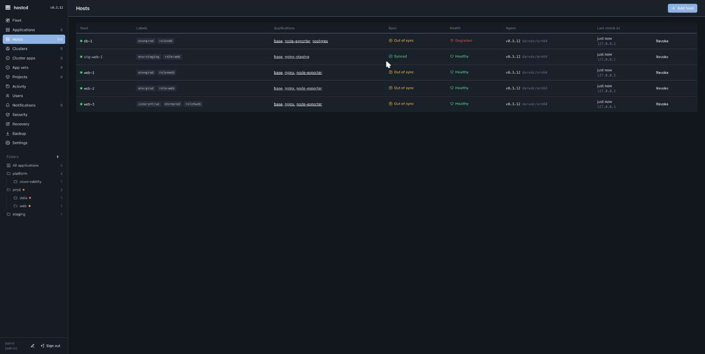

# hostcd — install

hostcd is two binaries managed by systemd: `hostcd-server` (one per fleet) and `hostcd-agent` (one per managed host). Linux with systemd is required. The supported host families are Ubuntu/Debian and RHEL/Rocky.

## Install the control plane

Run on the machine that will be your control plane (needs root for the systemd unit):

```sh
curl -fsSL https://github.com/Inblade/hostcd-dist/releases/latest/download/install.sh \
  | sudo env HOSTCD_RELEASE_BASE=https://github.com/Inblade/hostcd-dist/releases/latest/download \
    sh -s -- server
```

The installer downloads the signed binary, **verifies it** against the release `SHA256SUMS` (and cosign provenance when cosign is installed), installs the `hostcd-server` systemd unit, and generates `/etc/hostcd/server.env` with a random admin password and a shared agent-enrolment token. By default the server listens on `127.0.0.1:8080` — put TLS or a reverse proxy in front, or pass `-tls-cert`/`-tls-key`, before exposing it.

Open the UI and sign in as `admin` with the generated password (read it from `/etc/hostcd/server.env`).

## Enrol a host

The simplest path is **Add host → Install over SSH** from the UI: the server installs the agent over SSH and mints a per-host token automatically. To install by hand on the host instead:

```sh
curl -fsSL https://github.com/Inblade/hostcd-dist/releases/latest/download/install.sh \
  | sudo env HOSTCD_RELEASE_BASE=https://github.com/Inblade/hostcd-dist/releases/latest/download \
    sh -s -- agent https://<control-plane-host>:8080 <TOKEN>
```

The agent writes its token to `/etc/hostcd/agent.env`, starts dialing out, and appears in **Hosts** within seconds.



## Verify a download yourself

Every release publishes `SHA256SUMS` and a keyless cosign bundle. To check an artifact before trusting it:

```sh
cosign verify-blob SHA256SUMS \
  --bundle SHA256SUMS.cosign.bundle \
  --certificate-identity-regexp '^https://github.com/Inblade/hostcd/\.github/workflows/release\.yml@refs/tags/v.+$' \
  --certificate-oidc-issuer https://token.actions.githubusercontent.com
sha256sum -c SHA256SUMS
```

The public mirror is not re-signed, so the cosign identity stays the source repository's release workflow regardless of which mirror you downloaded from.

## Air-gapped / private mirror

Point `HOSTCD_RELEASE_BASE` at your own mirror (it may be plain HTTP on a trusted network). Pin the manifest out of band with `HOSTCD_EXPECTED_SHA256SUMS_SHA256=<sha256 of SHA256SUMS>` so the installer fails closed if the mirror is wrong or tampered.

Next: [concepts](concepts.md) · [operations](operations.md) · [security](security.md).
