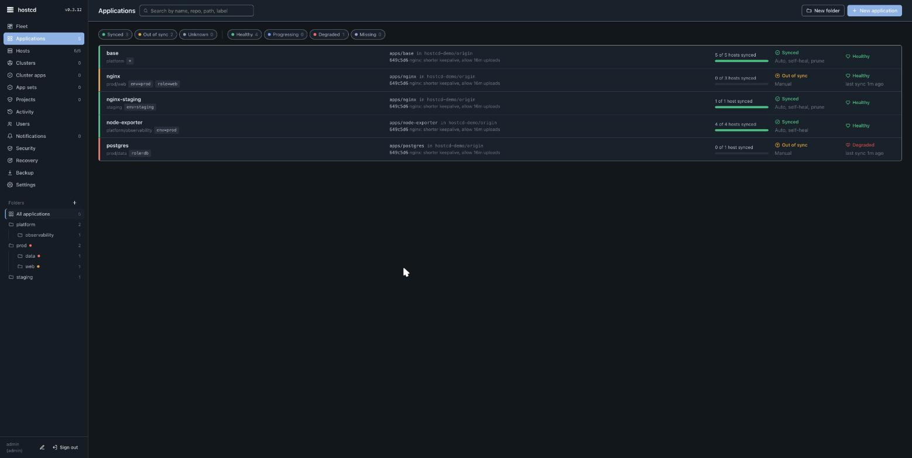
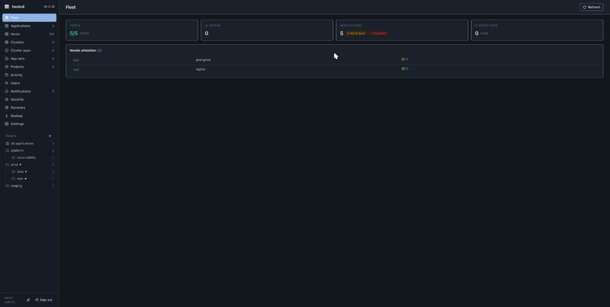

# hostcd — overview

> hostcd keeps every Linux server aligned with Git: continuous drift detection, self-healing, and safe, previewed rollouts for VMs and bare metal — without Kubernetes and without any inbound connection to the managed hosts.

## What it is

An **application** in hostcd points at a folder in a Git repository and at a set of hosts (by name or by label). The control plane (`hostcd-server`) renders that folder per host, compares the result to what is actually on the host, and shows any difference as a diff. You then **sync** (apply), **roll back**, or **prune** from a web UI or API. Each host runs a small **agent** that only dials out over HTTPS, so nothing listens on a managed host.

The technical analogy is "Argo CD for plain hosts", but the job is narrower and concrete: your Linux fleet continuously reconciled against a Git repo, the way Argo CD reconciles a Kubernetes cluster.



## Who it is for

Teams that have outgrown running Ansible by hand or on cron, but do not want to adopt Puppet/Rudder, move to NixOS, or pull ordinary servers into Kubernetes just to get GitOps. It targets **small-to-medium Linux fleets** (Ubuntu/Debian and RHEL/Rocky are the supported families).

## How it works

```
                 git (GitLab / GitHub / Gitea)
                            │  fetch, webhook
                ┌───────────▼───────────┐
                │     hostcd-server     │  UI + API, renders manifests per host,
                │   (one per fleet)     │  sync operations, history, rollback
                └───────────▲───────────┘
          long-poll HTTPS   │   (hosts only dial out, nothing listens on them)
        ┌──────────────┬────┴─────────┬──────────────┐
   hostcd-agent   hostcd-agent   hostcd-agent   hostcd-agent
     web-1          web-2           db-1          stg-web-1
```

- **Pull, not push.** Agents long-poll the server; the server never connects into a host. No inbound SSH or open agent port is required.
- **Per-host rendering.** A single application folder renders differently per host using host facts (hostname, OS id/version/family) and labels, so one manifest serves a heterogeneous fleet.
- **Preview before apply.** Drift is shown as a diff first; applying is an explicit operation (or automated per app), with full history and one-click rollback.



## Editions

| Edition | What you get |
|---|---|
| **Community** (free, BSL 1.1) | The full core: git → preview → rollout → audit, pull agent, all system resource kinds, drift/self-heal, backup/restore, upgrade/rollback. |
| **Team** (licensed) | Approval gates, outbound notifications (webhooks), audit export, a raised host limit. |
| **Enterprise** (licensed) | SSO (SAML/OIDC), SCIM, Postgres-backed HA, Vault Transit secret sealing. |

The supported release ships the **core only**. See [concepts](concepts.md) for the model, [install](install.md) to set it up, [security](security.md) for the trust model, and [operations](operations.md) for day-two tasks.
