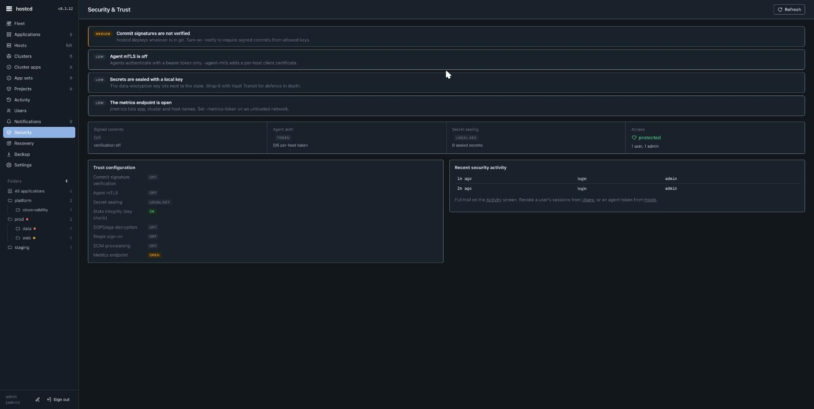

# hostcd — security model

hostcd is built so that managing a fleet does not widen its attack surface. The full policy and threat model live in the source repository's `SECURITY.md`; this is the operator-facing summary.

## Trust boundaries

- **Hosts only dial out.** The agent long-polls the server over HTTPS. Nothing listens on a managed host — there is no inbound SSH requirement and no open agent port.
- **Per-host agent tokens.** Install-over-SSH mints a fresh random token per host (stored as a digest server-side). A host's token authenticates only that host; revoking one does not affect others.
- **TOFU host keys.** SSH host keys are pinned on first use for install-over-SSH.
- **Optional agent mTLS.** `-agent-mtls` adds a per-host client certificate (P-256 CA) on top of the bearer token.

## Control-plane auth

- UI/API sign-in is bcrypt with lockout; sessions are cookie-based and `SameSite=Strict`, and every state-changing request must be `Content-Type: application/json` (a CSRF guard).
- Users are **admin** or **viewer**, optionally scoped by cluster, folder, or host labels.
- Enterprise adds **SSO** (SAML 2.0 and OIDC, with single logout) and **SCIM** provisioning.

## Secrets

The data-encryption key seals secrets in the server state with AES-256-GCM. For defence in depth, Enterprise can wrap it with **Vault Transit** instead of keeping a local key.

## Supply chain

Releases are built and signed in CI with **keyless cosign** (no private key in CI) and a published `SHA256SUMS` + SBOM. The public mirror is not re-signed, so artifacts stay independently verifiable against the source workflow's identity. See [install](install.md) for the verify command.

## Self-update is fail-closed

The opt-in one-click updater runs as root, unattended, so it is strict: it **requires cosign** (no HTTPS-only fallback), **pins one concrete release tag** (and aborts rather than follow a moving `latest`), and verifies the installer's **own** checksum and provenance **before** running it. It never escalates privilege from the server (which runs with `NoNewPrivileges`): the server writes a trigger file and a root systemd `.path` unit runs the update.

## Posture surfaced in the UI

The **Security & Trust** screen scores the live posture — commit-signature verification, agent mTLS, secret sealing, state integrity, SSO/SCIM, and whether the metrics endpoint is open — so you can see at a glance what is on and what to harden next. `-verify` requires signed commits from allowed keys; `-metrics-token` protects `/metrics` on an untrusted network.

Report vulnerabilities per the source repository's `SECURITY.md`. Next: [overview](overview.md) · [operations](operations.md).
