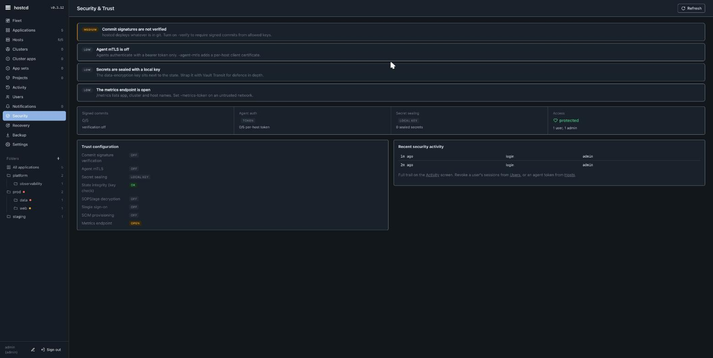

# hostcd — security model

hostcd is built so that managing a fleet does not widen its attack surface. The full policy and threat model live in the source repository's `SECURITY.md`; this is the operator-facing summary.

## Trust boundaries

- **Hosts only dial out.** The agent long-polls the server over HTTPS. Nothing listens on a managed host — there is no inbound SSH requirement and no open agent port.
- **Per-host agent tokens.** Install-over-SSH mints a fresh random token per host (stored as a digest server-side). A host's token authenticates only that host; revoking one does not affect others.
- **TOFU host keys.** SSH host keys are pinned on first use for install-over-SSH.
- **Optional agent mTLS.** `-agent-mtls` adds a per-host client certificate (P-256 CA) on top of the bearer token.

## Control-plane auth

- UI/API sign-in is bcrypt with lockout; sessions are cookie-based and `SameSite=Strict`, and every state-changing request must be `Content-Type: application/json` (a CSRF guard).
- Users are **admin** or **viewer**, optionally scoped by cluster, folder, or host labels.
- Enterprise adds **SSO** (SAML 2.0 and OIDC, with single logout) and **SCIM** provisioning.

## Secrets

The data-encryption key seals secrets in the server state with AES-256-GCM. For defence in depth, Enterprise can wrap it with **Vault Transit** instead of keeping a local key.

## Supply chain

Releases are built and signed in CI with **keyless cosign** and a published `SHA256SUMS` + SBOM. The public mirror is not re-signed, so artifacts stay independently verifiable against the source workflow's identity. See [install](install.md) for the verify command.

Agent self-upgrade adds one long-lived key: the release pipeline signs `agent-manifest.json` with a dedicated ed25519 key held only as a secret of the gated release environment, and the public half is compiled into every agent. An agent installs a new build only if that signature, the binary's sha256 and the version (newer than itself, equal to the request) all check out — see [operations](operations.md), "Agent self-upgrade".

## Self-update is fail-closed

The opt-in one-click updater runs as root, unattended, so it is strict: it **requires cosign** (no HTTPS-only fallback), **pins one concrete release tag** (and aborts rather than follow a moving `latest`), and verifies the installer's **own** checksum and provenance **before** running it. It never escalates privilege from the server (which runs with `NoNewPrivileges`): the server writes a trigger file and a root systemd `.path` unit runs the update.



## Posture surfaced in the UI

The **Security & Trust** screen scores the live posture — commit-signature verification, agent mTLS, secret sealing, state integrity, SSO/SCIM, and whether the metrics endpoint is open — so you can see at a glance what is on and what to harden next. `-allowed-signers` (or `-gpg-home`) requires signed commits from allowed keys; `-metrics-token` protects `/metrics` on an untrusted network.

## Hardening: agent mTLS and signed commits

Both are server start-up flags (the Settings page shows them read-only), need no external service, and can be turned on for a running fleet. Back up the state directory first and restart once.

**Agent mTLS.** Add `-agent-mtls` (it needs `-tls-cert`/`-tls-key`). The server becomes a small CA in its data directory. On the next poll every agent — Linux and Windows — is told to enrol, gets a per-host client certificate for its own name (stored in its state directory as `client.crt`/`client.key`) and retries; from then on a poll needs the token **and** that host's certificate, so a stolen token alone is useless. Agents renew the certificate 30 days before it expires. The browser UI on the same port keeps working without a certificate. Check: the server log shows `agent enrolled` once per host and every host stays online.

**Signed commits.** Pick the keys allowed to deploy and write them in an SSH `allowed_signers` file (`principal namespaces="git" ssh-ed25519 AAAA…`, one per line), then start the server with `-allowed-signers /etc/hostcd/allowed_signers` (or `-gpg-home DIR` with a keyring holding only the allowed GPG keys). Signers sign with plain git:

```bash
git config gpg.format ssh
git config user.signingkey ~/.ssh/deploy-signing.pub
git config commit.gpgsign true
```

What to know before switching it on:

- **Sign the branch head first.** Push a signed (even empty) commit to every repository your applications track *before* restarting with the flag; the application page then shows the signer.
- Only the commit an application deploys — the head of its tracked branch, or a revision you sync to — is checked, not its ancestors. A signer vouches for the tree they sign.
- An unsigned or wrongly signed head is **rejected**: hosts stay on the last verified revision (the application shows "rejected … hosts stay on …", and its Sync/Health still reflect the hosts against that revision) until a signed commit lands. After a server restart the server falls back to the newest revision the application already deployed, if it still verifies, so self-heal keeps running.
- Commits made in a forge's web editor are signed by the forge's own key (or not at all) and are rejected unless you allow that key. Keep the signing key safe: losing it means adding a new key to `allowed_signers` and restarting.

Report vulnerabilities per the source repository's `SECURITY.md`. Next: [overview](overview.md) · [operations](operations.md).
